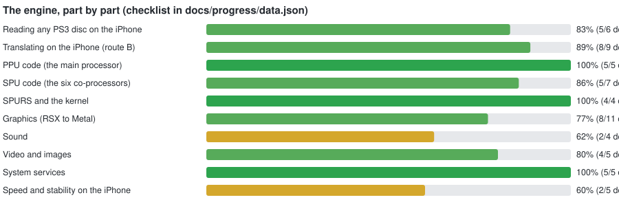
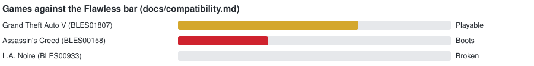
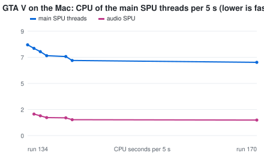
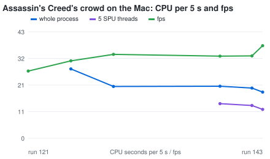
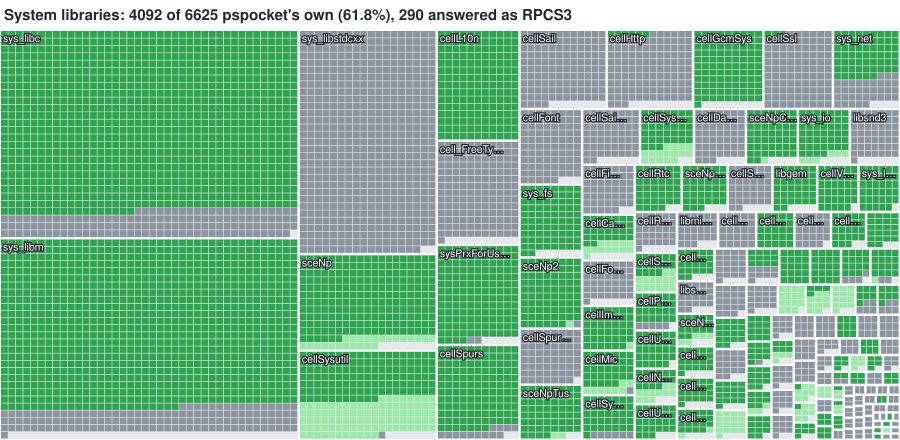
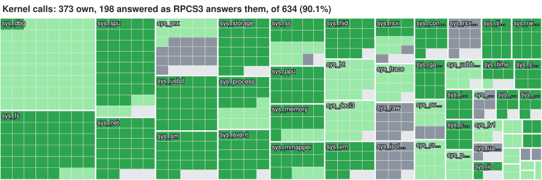

# pspocket

Runs PS3 games natively on the iPhone. pspocket is a static recompiler, not an emulator: a game's PowerPC (PPU) and SPU
code is translated ahead of time to C and compiled to ARM64, its graphics go to Metal and its sound to AVAudioEngine.
The goal (route B, D-147): the iPhone alone takes any PS3 disc image, translates the game once ("Preparing game…"),
signs and loads it, and plays it flawlessly. Driving title: GTA V (BLES01807); second: Assassin's Creed (BLES00158).

- Where things stand: [docs/status.md](docs/status.md) · Decisions: [docs/decisions.md](docs/decisions.md) · Rules:
  [CLAUDE.md](CLAUDE.md) · Plan: [docs/plan.md](docs/plan.md)
- Private, personal project. The repo contains no Sony or Rockstar code, keys, firmware or assets, and never will.

<!-- progress:start (generated by scripts/progress.py; do not edit by hand) -->
## Status

     

_2026-10-07, after runs 142-149 (D-220)._ Route B (D-147): the iPhone alone prepares any PS3 disc image and runs it as native ARM64 code, no emulation. GTA V plays (Playable), Assassin's Creed plays into its training on the Mac; nothing is Flawless yet: the iPhone is too slow in heavy scenes and GTA V's EDGE job chain stops now and then.










Green: pspocket's own code. Light green: answered as RPCS3's own stub answers. Grey: not yet pspocket's own (served by the PS3's own firmware module when the system software is installed, D-175). Counted against every function RPCS3 registers, not every function the PS3 has.



PPU instructions: 380 of 382 translated, each checked against the interpreter by the differential fuzz tests (the two left out, eciwx and ecowx, are external control instructions games do not use). SPU instructions: 194 of 199 (the five left out are ISA 1.2 double-precision compares the PS3's SPUs do not have).

Per game: [docs/compatibility.md](docs/compatibility.md) · runs: [docs/runs](docs/runs/README.md) · where each part can improve: [docs/improve.md](docs/improve.md)
<!-- progress:end -->

## Build

```sh
cmake -S . -B build/host -G Ninja -DPSPOCKET_WERROR=ON
ninja -C build/host
ctest --test-dir build/host --output-on-failure
./build/host/runtime/platform/macos/pspocket-selftest
```

Clang only (D-026). On Linux: `CC=clang CXX=clang++ cmake ...`; the AArch64-only paths are tested under qemu with
`-DCMAKE_TOOLCHAIN_FILE=cmake/toolchains/linux-aarch64-qemu.cmake` (D-027).

iOS test host on a connected iPhone: `scripts/ios.sh all` (see [app/ios/README.md](app/ios/README.md)).

## Layout

See [CLAUDE.md](CLAUDE.md#layout).
